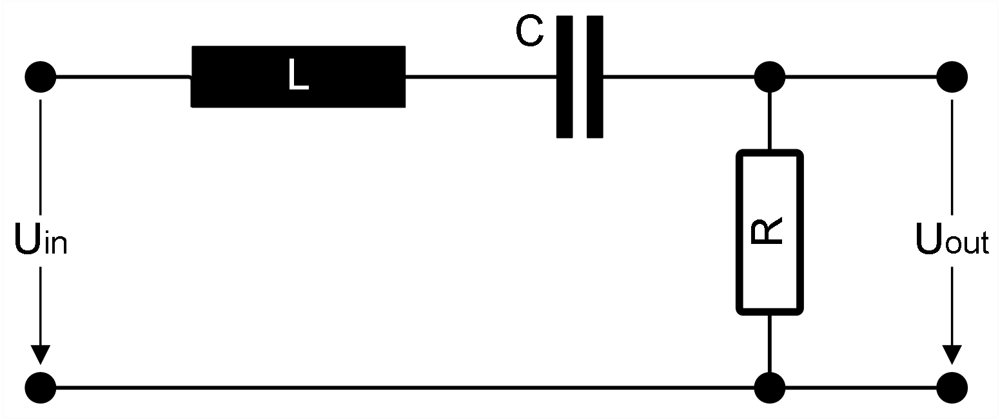
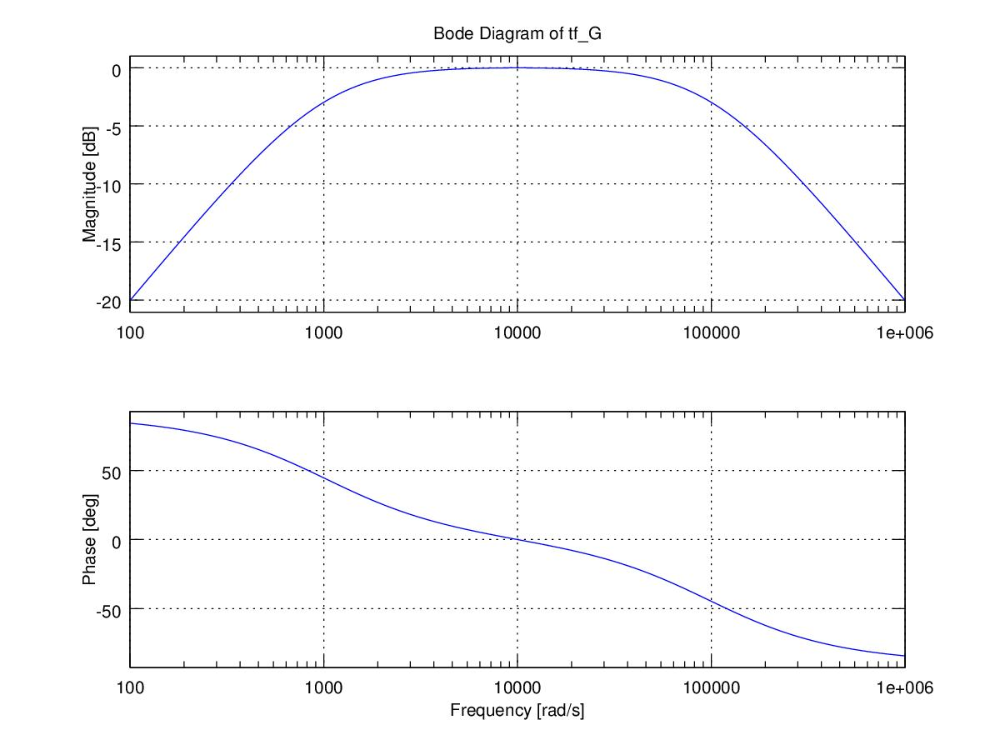

= linNet, the Software for symbolic Analysis of linear Electronic Circuits
:Author:            Peter Vranken
:Email:             mailto:Peter_Vranken@Yahoo.de[P. Vranken]
:xrefstyle:         short

linNet is an application for computing the transfer function of linear
electronic circuits. The computation is performed symbolically rather than
numerically, and the result is a formula rather than a number or a series
of numbers. The resulting formula is the Laplace transform describing the
dependencies of the voltages and currents in the circuit on the input
voltages and currents. 

A linear electronic circuit is a combination of the supported basic
devices listed in <<tabSupportedDevices>>. The circuit is input to
linNet. The representation of the circuit is a list of devices with
connectivity information. The interconnections are expressed by references
to nodes, where a node is a point in the circuit to which normally at
least two devices are connected. This leads to a simple formal syntax, the
circuit network list, or simply netlist. This list can be created and
maintained with a text editor; there is no graphical interface for editing
a circuit.

The computed formulas are printed to the console and to the application
log file and can be used for further investigation, publications, or
didactic purposes.

[[tabSupportedDevices]]
.Supported linear electronic devices
//[caption="Table 1: "]
[options="header",cols="<6,^2", width="50%"]
|=======
|Device |Symbol

|Resistor |R
|Conductance |Y
|Capacitor |C
|Inductivity |L
|Ideal operational amplifier (op-amp) |OP
|Constant voltage source |U
|Voltage controlled voltage source |U(U)
|Current controlled voltage source |U(I)
|Constant current source |I
|Voltage controlled current source |I(U)
|Current controlled current source |I(I)
|Current probe (wire) |PI
|=======

To make the application somewhat more attractive, it also exports the
computed formulas as GNU Octave or MATLAB script code. Numeric evaluation
then becomes a simple one-line command in Octave. The formulas are
exported as LTI transfer function objects so that the complete set of
analysis functions from the Octave Control package can be applied
directly. This ranges from simple transfer function plotting to stability
analysis and the computation of system responses to arbitrary inputs.

[[figFirstIntroExample]]
.Titel Simple example of a linear electronic circuit

Please refer to <<figFirstIntroExample>> for an example of how
linNet works. This is a simple RLC circuit with a second-order transfer
function. It can be represented by the following circuit netlist:

    U Uin in  gnd
    L L   in  K1
    C C   K1  out
    R R   out gnd
    PLOT G U_out U_in

If this netlist is stored in file `rlc.cnl`, we can run linNet:

    linNet -o rlc.cnl

This would yield the output:

    User-defined result G (Bode plot):
    The dependency of U_out on U_in:
      U_out(s) = N_U_out_U_in(s)/D_U_out_U_in(s) * U_in(s), with
        N_U_out_U_in(s) = R*C * s
        D_U_out_U_in(s) = L*C * s^2
                          +R*C * s
                          +1

The command line switch -o made linNet generate Octave script `G.m`. Going
to Octave and typing `G` to plot the transfer function gives us
<<figOctaveOutput>>. For this plot, Octave used default values for _R_,
_L_ and _C_. Additional plots or plots with modified device values are
then a matter of single commands in Octave.

[[figOctaveOutput]]
.Titel Octave plot using the linNet generated LTI object

For detailed information about linNet, including installation
instructions, the netlist syntax, the Octave interface, and the
mathematical concepts behind the program, please refer to the user guide,
link:doc/userGuide/linNet-userGuide.pdf[linNet-userGuide.pdf^].

//The source code of linNet is hosted at GitHub; please see
//link:https://github.com/PeterVranken/linNet/tree/main/[https://github.com/PeterVranken/linNet/tree/main/].
//In the repository's _Releases_ area, you find the links to download
//ready-to-use distributions with manual, samples and executable binaries
//for Windows. Mac and Linux users will have to compile the software, the
//makefile and source code files are prepared to do so.

linNet means "linear network". It is based on a symbolic solver for
linear equation systems. There is no way to model non-linear effects such
as noise, voltage or current limits, non-linear distortions, or switching
operations. All of these effects play an important role in real electronic
circuits, and many circuits even use these effects as their principle of
operation. You will not find linNet helpful for the investigation of
such effects or circuits. There are many numeric circuit simulation tools
that are capable of this, first and foremost the popular open-source tool
SPICE and its many derivatives. linNet is conceptually not a competitor
to these tools, although it can behave somewhat similarly when using
Octave as a numeric post-processor. linNet is not the worse SPICE;
linNet is different. 