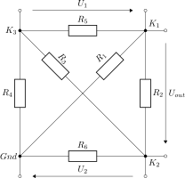

This folder contains linNet test case `4Nodes.jpg`:

[[figSchematics]]
.Schematics

Four nodes and a branch in between all nodes to get a maximally complex
structure of the LES.

Check:

Uout(U~1~):

. U~1~ shortcuts R~5~, R~5~ has no impact.
. U~2~ shortcuts R~6~; R~6~ has no impact.
. Node 2 become same as node gnd.
. R~4~ is parallel to R~3~; the pair can be replaced by R~34~=R~3~*R~4~/(R~3~+R~4~)
. R~1~ is parallel to R~2~; the pair can be replaced by R~12~=R~1~*R~2~/(R~1~+R~2~)
. U~1~ feeds a voltage divide of R~34~ and R~12~; Uout is the negative voltage at R~12~
. Uout=-R~12~/(R~12~+R~34~); this leads soon to linNets result:

----
                      -(R1*R2*R3 + R1*R2*R4)
Uout(U1) = ---------------------------------------------
            (R1*R2*R3 + R1*R2*R4 + R1*R3*R4 + R2*R3*R4)
----

And analogously for Uout(U~2~).

link:4Nodes.log[Calculation results^]

See link:4Nodes.cnl[netlist file^] for more details of
the circuits. 
