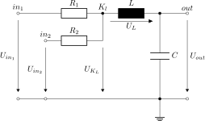

This folder contains linNet test case `MIMO`:

[[figSchematics]]
.Schematics

An LC element with two independently injected input voltages serves as a
simple MIMO system. Three voltages are calculated and form the system
outputs.

In the numeric post-processing, Octave shows a
link:MIMO/MIMO.svg[matrix-plot^] with the step function of every output
voltage depending on both inputs (while it assumes the other input to be
zero).

link:MIMO.log[Calculation results^]

See link:MIMO.cnl[netlist file^] for more details of the circuit.
