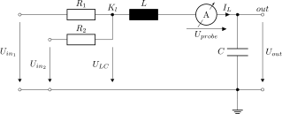

This folder contains linNet test case `RLC`:

[[figSchematics]]
.Schematics

An RLC combination, a system of 2nd order.

The netlist  demonstrates the use of user-defined voltages and
user-defined results.

link:RLC.log[Calculation results^]

See link:RLC.cnl[netlist file^] for more details of the circuit.
