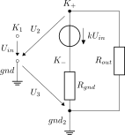

This folder contains linNet test case `badUserVoltageAcrossSubNetworks`:

[[figSchematics]]
.Schematics

In a basically well-defined circuit consisting of two unconnected
sub-networks, user-defined voltages make the calculation fail; the
potential difference between the two sub-networks is undefined and a
voltage between nodes from both sub-networks is hence undefined, too.
linNet rejects this netlist.

Note, the same circuit without the bad voltage definitions can be
found as link:../srcUByU[`srcUByU`] and can be computed.

link:badUserVoltageAcrossSubNetworks.log[linNet calculation log file with error messages^]

See link:badUserVoltageAcrossSubNetworks.cnl[netlist file^] for more details of
the circuits. 
