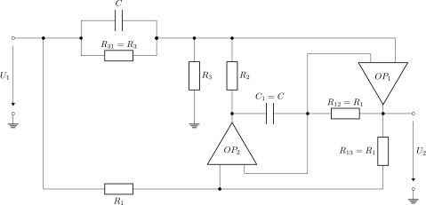

This folder contains linNet test case `bandStop`:

[[figSchematics]]
.Schematics

The circuit implements a band stop filter. This is the
link:bandStop.log[calculation result^] as linNet produces it:

----
        U2(s)             R1*R2*R3*C^2 * s^2 + R3
G(s) = -------  = -----------------------------------------
        U1(s)      R1*R2*R3*C^2 * s^2 + 2*R1*R2*C * s + R3
----

If we compare this result with the canonical form of a band stop:

----
             s^2 + w0^2
G(s) = -----------------------
        s^2 + (w0/Q)*s + w0^2

                        1
             s^2 + -----------
                    R1*R2*C^2
     = --------------------------------
                2               1
        s^2 + ------ * s + -----------
               R3*C         R1*R2*C^2
----

then we can identify:

----
            1
w0 = ---------------
      SQRT(R1*R2)*C

          R3
Q = ---------------
     2*SQRT(R1*R2)
----

The transfer function has a zero at s^2^=-w~0~^2^ or s=jw~0~; so the
frequency f~0~=w~0~/(2*pi) is entirely filtered out. This is the meaning
of a notch filter.

See link:bandStop.cnl[netlist file^] for more details of the circuit.
