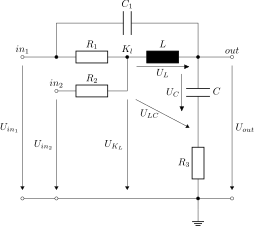

This folder contains linNet test case `directCapacitiveCoupling`:

[[figSchematics]]
.Schematics

An RLC element with an additional capacity, which couples in- and output
directly and which makes it a system of 3^rd^ order. The directly coupling
capacitor makes the power of numerator and denominator of the transfer
function equal and leads to a Dirac impulse in the
link:directCapacitiveCoupling/Impulse.svg[impulse response^]footnote:[
  The Octave plot of the impulse response is not directly produced by the
generated M scripts. To produce this image, we typed in Octave: `tf=U_out;
impulse(tf)`.].
  For the plot of the link:directCapacitiveCoupling/Step.svg[step
function^], this is anyway uncritical.

In the numeric post-processing, Octave handles this very well. Of course,
it can't plot the Dirac function but it prints:

----
Warning: System "tf" has direct feedthrough!
The impulse 1.000000*delta(t) is omitted in the impulse response from input "U1" to output "U_out"
----

link:directCapacitiveCoupling.log[Calculation results^]

link:directCapacitiveCoupling/U_out_by_Uin1.svg[Frequency response^]

See link:directCapacitiveCoupling.cnl[netlist file^] for more details of the circuit.
