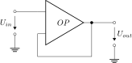

This folder contains linNet test case `inputImpedanceInfinite`:

[[figSchematics]]
.Schematics

An op-amp based input follower has an infinite impedance. This is
calculated correct by linNet but the resulting
link:inputImpedanceInfinite/Z.m[Octave code^] creates a transfer function
object, which Octave would fail to calculate. The M code generator of
linNet adds an error message to the script in order to avoid confusion.

link:inputImpedanceInfinite.log[Calculation results^]

See link:inputImpedanceInfinite.cnl[netlist file^] for more details of
the circuits. 
