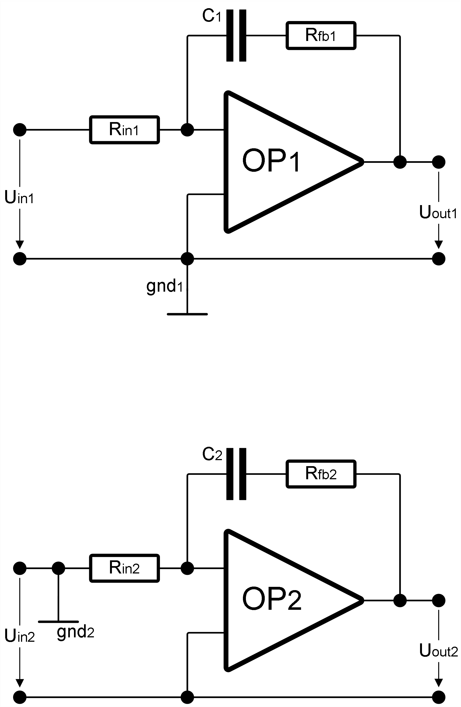

This folder contains linNet test case `opampWithDifferingGnds.jpg`:

[[figSchematics]]
.Schematics

This circuit demonstrates the importance of the ground node definition,
when op-amps are used. The netlist defines twice the same op-amp
circuit (a PI-controller); both times declaring another node as ground
node.

The ground node has an impact on how an op-amp is internally modelled
with a controlled voltage source, and choosing different nodes alters
the internal calculation model. The transfer function is identical in
both cases but the input impedances differs.

This is an example from the linNet manual. The manual shows for the
same circuit a third choice of the ground node, which makes the
calculation even fail and abort. Why all of this happens and what to do
is explained in the linNet manual, section 5.4, The operational
amplifier.

link:opampWithDifferingGnds.log[Calculation results^]

See link:opampWithDifferingGnds.cnl[netlist file^] for more details of
the circuits. 
