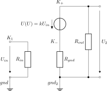

This folder contains linNet test case `srcUByU`:

[[figSchematics]]
.Schematics

Introduction of the voltage controlled voltage source:

The input voltage in the first circuit is at the same time the
control voltage of the voltage source in the second circuit. The second
source drives a voltage divider. The divided voltage is defined to
become the system output voltage U2.

The two circuits form unconnected sub-networks. This requires the
definition of a ground node in each circuit; otherwise linNet would
autonomously select an arbitrary node as ground and all voltages, which
are not user-defined (and which are thus node potentials) were no longer
transparently defined.

The expected result is: U~2~ = k*U~in~*R~out~/(R~gnd~+R~out~).

Please compare with the link:srcUByU.log[calculated result^].

See link:srcUByU.cnl[netlist file^] for more details of the circuits.
