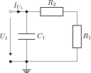

This folder contains linNet test case `stepWithDirac`:

[[figSchematics]]
.Schematics

This test case proves, that linNet has no problems with a system, which
has a nominator power in s that is greater than the denominator power. In
this circuit we get such a result for the input current I~U1~ due to the
directly connected capacitor C~1~. Look for `I_U1` in the
link:stepWithDirac.log[calculation results^] .

Octave has problems to plot the step function, which would contain
a Dirac function and emits the unspecific error message: "This
descriptor system cannot be converted to regular state-space form."
MATLAB also rejects the plot but it responds with a clear and
appropriate error message.

The impulse response, which contains a higher-order Dirac impulse,
certainly cannot be represented. How MATLAB behaves in this case is
unknown.

Plotting the link:stepWithDirac/G_I_U1.svg[frequency response^] is however not an
issue. The higher degree of the numerator is clearly reflected here in the
curve, which tends towards infinity for high frequencies.

See link:stepWithDirac.cnl[netlist file^] for more details of the circuit.
