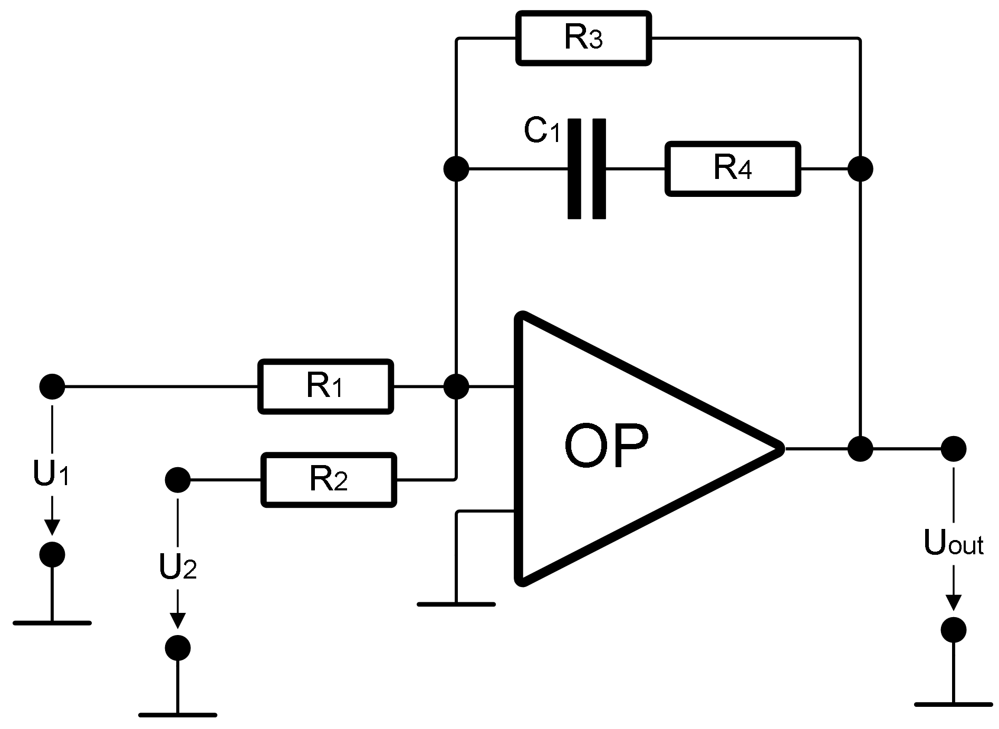

This folder contains linNet test case `useCaseAnalogAdd`:

[[figSchematics]]
.Schematics

This test demonstrates an analog added with additional low-pass
characteristics. It is an example from the linNet manual, see Chapter 8,
Typical Use Cases, for a discussion.

The two inputs are weighted in a ratio 1:2. The DC amplification is 4
and 8 for the first and second input, respectively. Due to the filter
characteristics, the amplification is reduced by a factor of ten for
high frequencies.

link:useCaseAnalogAdd.log[Calculation results^]

See link:useCaseAnalogAdd.cnl[netlist file^] for more details of the
circuit.
