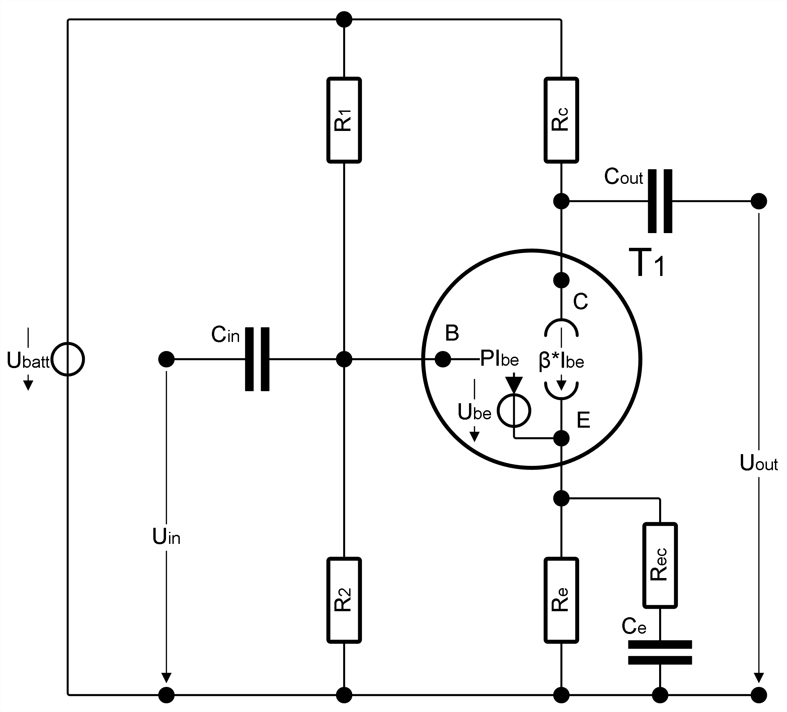

This folder contains linNet test case `useCaseBipolarTModel`:

[[figSchematics]]
.Schematics

Single stage linear audio amplifier using bipolar transistor. Both,
link:useCaseBipolarTModel/G.svg[frequency response^] and DC operation point
of the stage can be discussed based on the linNet
link:useCaseBipolarTModel.log[calculation results^].

The circuit is an example from the
link:../../../doc/userGuide/linNet-userGuide.pdf[linNet manual^], see
Chapter 8.3, Transistor model, for the detailled discussion.

An added, manually made M script,
link:useCaseBipolarTModel/BipolarTModel_opRangeByLsim.m[`BipolarTModel_opRangeByLsim.m`^],
helps understanding what the strictly linear behavior of linNet means --
what can be simulated, what fails to simulate.

See link:useCaseBipolarTModel.cnl[netlist file^] for more details of the
circuit.
