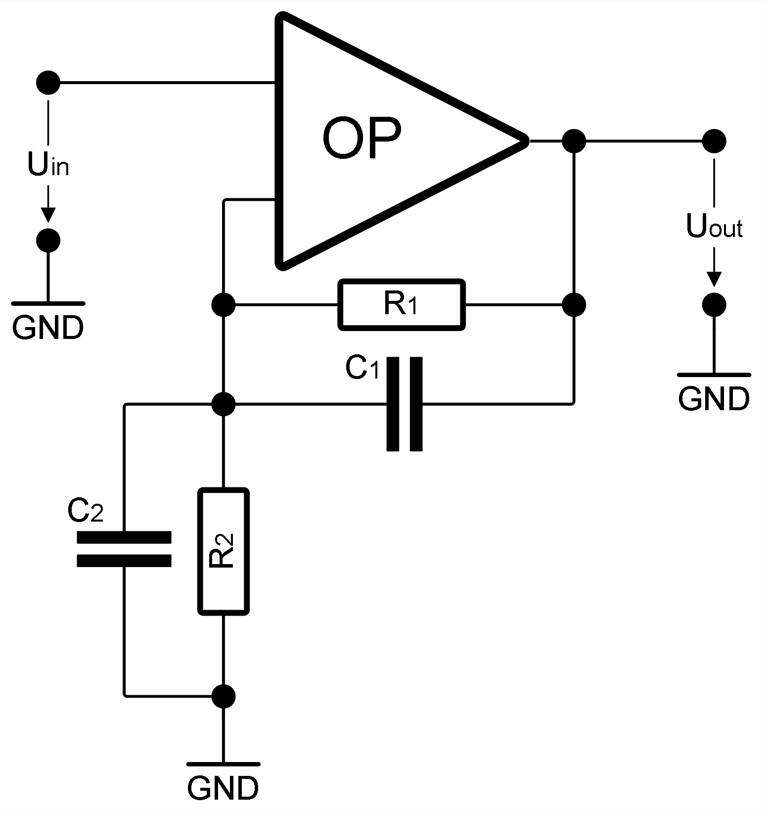

This folder contains linNet test case `useCaseOpFilter`:

[[figSchematics]]
.Schematics

This test demonstrates an op-amp filter with two time-constants. It is an
example from the linNet manual, see Chapter 8, Typical Use Cases, for a
discussion. The link:useCaseOpFilter/G.svg[frequency response^] can be
calculated with Octave in the numeric post-processing.

One of the signals the link:useCaseOpFilter.cnl[netlist] defines is the
current I~OP~, the output current of the op-amp. This is an instable
system. The numerator has a higher power in s as the denominator and the
current exceeds any limit for increasing frequencies. The numeric Octave
post-processing fails to plot the step function for this system; generated
script `SIMO.m` aborts with error. However, the Bode plot for the same
signal can be plotted; script `Iop.m` executes well.

link:useCaseOpFilter.log[Calculation results^]
