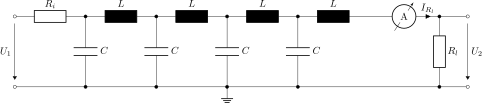

This folder contains linNet test case `wire`:

[[figSchematics]]
.Schematics

This circuit implements a simple model of an electric wire. The wire
is modelled as n identical elements, where each element is a serial
inductivity and a parallel capacitance. 

Here, we have the implementation with n=4 LC elements.

The order in s and the computation calculation rise drastically with each
added LC element. n=7 is the greatest n with negligible computation time
and n=10 is the greatest n, which has ever been computed. The computation
for n=10 took about 26 hours. Extrapolating the computational effort we
can expect a couple of months of computation time for n=11.

Unfortunately, n=7 is the greatest n, which can be handled numerically by
Octave 10.2 (elder revisions are worse). MATLAB doesn't have this
limitation. It still shows reasonable results for the higher n.

The link:wire4/stepResp.svg[step response^] of the system shows a stepwise
increase of the output voltage till the final value of half the input
voltage is reached. This is due to reflections at the ends of the wire.
The greater n the clearer this pattern becomes.

The depenceny U~2~(U~1~) has been specified twice in the
link:wire4.cnl[netlist file^]: Once using keyword `BODE` once using `RES`.
The leads twice to the same link:wire4.log[calculation result^], but the
generated Octave scripts behave differently. `G.m` creates a Bode plot of
the link:wire4/G.svg[frequency response^], while `stepResp.m` plots the
link:wire4/stepResp.svg[step response^].footnote:[
  Please note, the double result definition has been done for convenience
only; both of the scripts can be used to plot frequency response, impulse
and step responses, etc. Just the default plot behavior makes the
difference. See Octave help of the scripts for details.]
