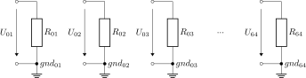

This folder contains linNet test case `largeAndSimple`:

[[figSchematics]]
.Schematics

This test case demonstrates that the maximum supported number of devices,
64, can be used safely. To avoid excessive or even pseudo-infinite
computation times, the circuit topology is intentionally kept as simple as
possible. In fact, the network consists of 64 independent and otherwise
trivial sub-circuits.

The definition of the full result `I01_I64_full` in the
link:largeAndSimple.cnl[netlist file^] requests the currents delivered by
sources U~01~ and U~64~. The two corresponding
link:largeAndSimple.log[calculation results^] are formally expressed as a
function of all sources. As expected, however, all coefficients are zero
except for the one describing the dependency on U~01~ (or U~64~,
respectively). This remaining coefficient is, of course, the reciprocal of
R~01~ (or R~64~, respectively).

All other result definitions, `I_01`, `I_02`, ..., `I_64`, request the
dependency of the current delivered by a source on the voltage of that
same source. As expected, the result corresponds to Ohm's law:
I~n~ = 1/R~n~ * U~n~

The generated link:largeAndSimple[Octave scripts^] are correct, although
they do not provide any additional insight for this particular test case.
