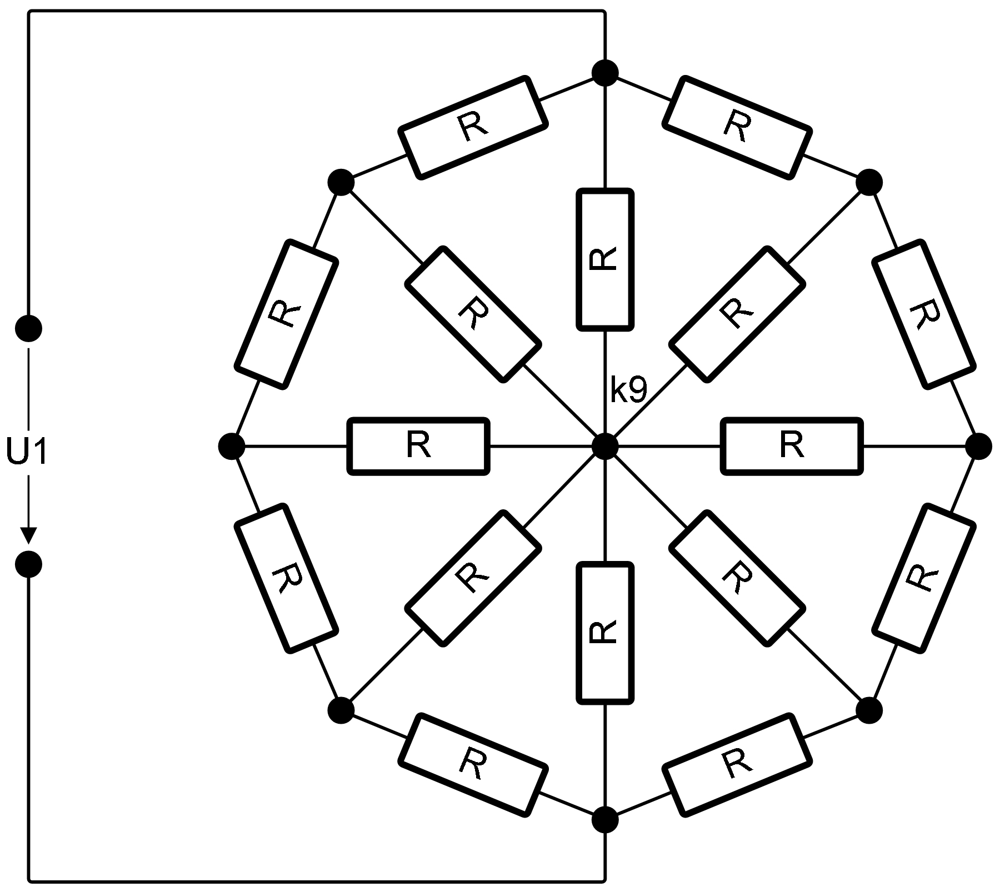

This folder contains linNet test case `octagon`:

[[figSchematics]]
.Schematics

This is an interesting test case because it clearly demonstrates the large
gap between human understanding and the machine's brute-force
computational power. Determining the resistance value of the elegant
wheel-shaped network of identical resistors can be solved within a few
minutes. Symmetry considerations allow dramatic simplifications:

The horizontal resistors connect nodes at the same potential on both
sides. As a result, no current flows through them and they are therefore
irrelevant to the final result. Conceptually, they can be replaced by a
wire, through which no current flows either.

The remaining upper and lower halves are mirror images of each other, so
it is sufficient to calculate the result for one half and then double it.

The upper half can be understood as a parallel connection of three
elements: the vertical resistor and two identical inverted Y-shaped
networks. From these elements we obtain:

----
R_y = R + R||R = 3/2*R
R_y||R_y = 1/2*R_y = 3/4*R
R_y||R||R_y = R||(R_y||R_y) = R*(3/4*R)/(R+3/4*R) = 3/4*R/(7/4) = 3/7*R
R_tot = 2*(R_y||R||R_y) = 6/7*R
----

In contrast to this reasoning, linNet sets up a system of equations
without even taking advantage of the fact that all resistors are
identical. It solves the system in the most general form, allowing every
resistor to have a different value, and only substitutes the common value
`R` into the resulting formula afterwards. For a human, this would be a
practically impossible task.

In the end, however, both approaches lead to the same result.

The resistor network is defined in the link:octagon.cnl[netlist file^].
