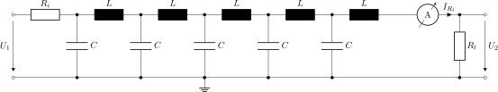
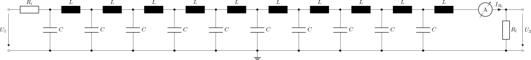

This folder contains linNet test case `wire`:

[[figWire4]]
.Electric wire, emulated by four LC elements
image::Wire4.svg[Schematics wire4, width="48%", pdfwidth="48%", align="center"]

[[figWire5]]
.Electric wire, emulated by five LC elements

...

[[figWire10]]
.Electric wire, emulated by ten LC elements

These circuits implement a simple model of an electric wire. The wire
is modelled as n identical elements, where each element is a serial
inductivity and a parallel capacitance. 

The folder contains implementations with n=4..10 LC elements.

The order in s and the computation complexity rise drastically with each
added LC element. n=7 is the greatest n with negligible computation time
and n=10 is the greatest n, which has ever been computed. The computation
for n=10 took about 26 hours. Extrapolating the computational effort we
can expect a couple of months of computation time for n=11.

Unfortunately, n=7 is the greatest n, which can be handled numerically by
Octave 10.2 (elder revisions are worse). MATLAB doesn't have this
limitation. It still shows reasonable results for the higher n.

The step response of the system shows a stepwise increase of the output
voltage till the final value of half the input voltage is reached. This is
due to reflections at the ends of the wire. The greater n the clearer this
pattern becomes.

[[tabVariants]]
.The implemented variants
[options="noheader",cols="2,2,2,2,2", width="80%"]
|=======
|4 LC elements
|link:wire4/G.svg[Frequency Response^]
|link:wire4/StepResp.svg[Step Response^]
|link:wire4.cnl[Netlist^]
|link:wire4.log[Calculation Result^]

|5 LC elements
|link:wire5/G.svg[Frequency Response^]
|link:wire5/StepResp.svg[Step Response^]
|link:wire5.cnl[Netlist^]
|link:wire5.log[Calculation Result^]

|6 LC elements
|link:wire6/G.svg[Frequency Response^]
|link:wire6/StepResp.svg[Step Response^]
|link:wire6.cnl[Netlist^]
|link:wire6.log[Calculation Result^]

|7 LC elements
|link:wire7/G.svg[Frequency Response^]
|link:wire7/StepResp.svg[Step Response^]
|link:wire7.cnl[Netlist^]
|link:wire7.log[Calculation Result^]

|8 LC elements
|link:wire8/G.svg[Frequency Response^]
|(Octave fails to plot `stepResp.m`)
|link:wire8.cnl[Netlist^]
|link:wire8.log[Calculation Result^]

|9 LC elements
|link:wire9/G.svg[Frequency Response^]
|(Octave fails to plot `stepResp.m`)
|link:wire9.cnl[Netlist^]
|link:wire9.log[Calculation Result^]

|10 LC elements
|link:wire10/G.svg[Frequency Response^]
|(Octave fails to plot `stepResp.m`)
|link:wire10.cnl[Netlist^]
|link:wire10.log[Calculation Result^]

|=======

The depenceny U~2~(U~1~) has been specified twice in the netlist files:
Once using keyword `BODE`, once using `RES`. This leads twice to the same
calculation result, but the generated Octave scripts behave differently.
`G.m` creates a Bode plot of the frequency response, while `stepResp.m`
plots the step response.footnote:[
  Please note, the double result definition has been done for convenience
only; both of the scripts can be used to plot frequency response, impulse
and step responses, etc. Just the default plot behavior makes the
difference. See Octave help of the scripts for details.]
